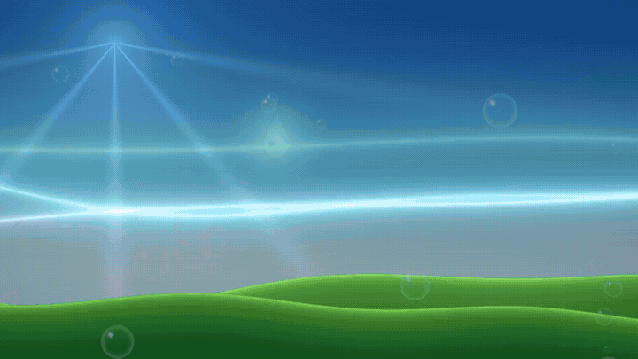
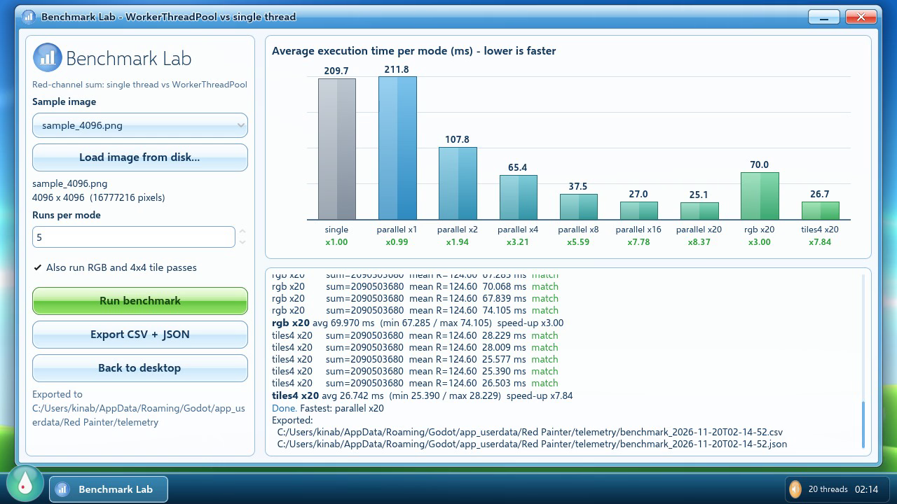
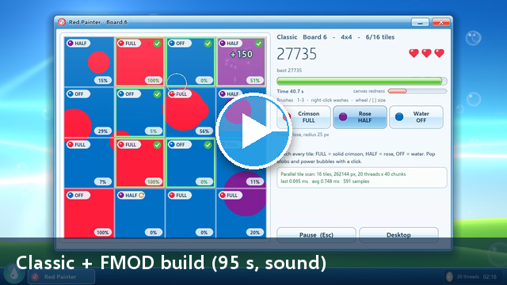
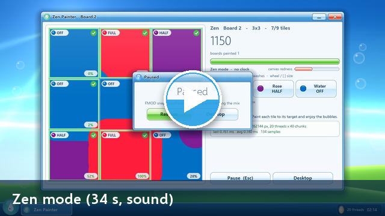
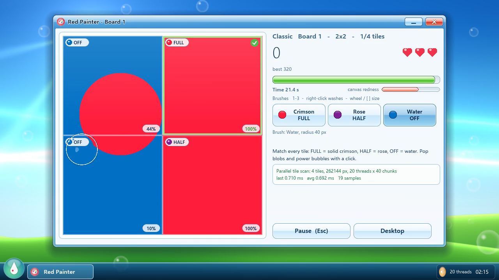
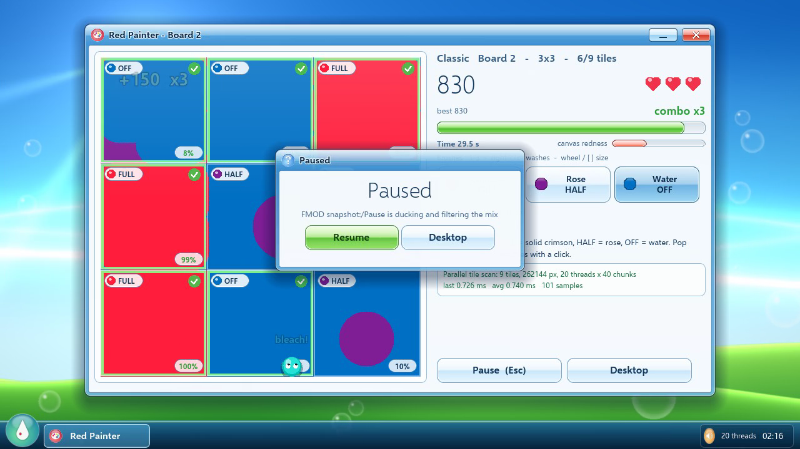

# Technical Commentary / Devlog: Red Painter

**Engine:** Godot 4.7.2 (GDScript) · **CPU:** Intel Core i7-12700KF (12 cores / 20 threads) · **Middleware:** FMOD Studio 2.03 via `fmod-gdextension`

Red Painter is a speed-painting puzzle game wrapped in a Frutiger Aero "operating system". It boots to a glossy desktop with icons, draggable glass windows, a start orb and a taskbar. Each board is a grid of tiles, and each tile has a target: FULL (crimson), HALF (rose) or OFF (water). Hazards and power bubbles push against you: bleach and spiller blobs, shifting tiles, Freeze, Bucket, Mega brush, Rinse and +Time. The red channel of the whole canvas is summed in parallel ten times a second. Those sums score every tile and drive the adaptive FMOD music.

---

## Part 1: Parallel Processing

### Implementation
The brief names Unity Jobs and Unreal ParallelFor. Godot's equivalent is **`WorkerThreadPool.add_group_task(callable, elements, tasks_needed)`**. It runs one callable per element index across a pool with one worker per logical core, which is the same model as `IJobParallelFor` or `ParallelFor`.

`scripts/red_sum.gd` contains four paths:
- **`sum_single`**: the baseline. It reads every 4th byte (R) of the RGBA8 buffer on one thread.
- **`sum_parallel`**: splits the rows into bands (4 per thread). Each band sums into a local variable and writes one partial total into its own slot. The main thread waits on `wait_for_group_task_completion` and adds up the partials. The pixel buffer is shared read-only, so the hot loop needs no locks.
- **`sum_tiles`**: used by the game. Each band also splits its rows into N×N tile columns and returns per-tile partials. One parallel pass scores the whole board.
- **`sum_rgb_parallel`**: sums R, G and B in one pass.

Images are loaded from disk with `Image.load_from_file` (a native file dialog, or `--image=` on the command line) and converted to RGBA8. A headless test (`tests/test_red_sum.gd`) checks every path against known totals, and checks the per-tile sums against `Image.get_region` with uneven grids and chunk counts.

### Telemetry
Every run records its mode, threads, chunks, resolution, sum, mean R and `Time.get_ticks_usec` duration. The `Telemetry` autoload prints `[RedSum]` lines and exports CSV + JSON with the CPU name and core count. The Benchmark Lab runs each mode 5 times on a background `Thread`, charts the averages and checks every parallel sum against the single-thread sum. In play, each session writes a JSON file with the average and p95 scan time.

Results for a 4096² image loaded from disk, measured in the exported build (`media/benchmark_telemetry.csv`):

| Mode | Avg ms | Speed-up |
|---|---|---|
| single | 209.7 | ×1.00 |
| parallel ×2 | 107.8 | ×1.95 |
| parallel ×4 | 65.4 | ×3.21 |
| parallel ×8 | 37.5 | ×5.59 |
| parallel ×16 | 27.0 | ×7.77 |
| parallel ×20 | 25.1 | ×8.35 |
| tiles 4×4 ×20 | 26.7 | ×7.85 |

In the game, the 512² canvas scan averaged **0.75 ms** (under 5% of a 60 fps frame).

*Benchmark Lab in the exported build: [full video](media/benchmark.mp4). Below, the chart and the per-run log output, where every parallel sum is checked against single-thread ("match").*

### How the results inform optimisation
Scaling is almost linear up to 8 workers, matching the 8 performance cores. From 16 to 20 threads the gain is 7%: the E-cores and SMT siblings add little to a memory-bound loop. Sizing the pool to the physical cores would cost almost no speed and leave threads free for the game. Splitting into tiles costs about 6% over a flat scan, so per-region analysis is nearly free once the work is parallel. Parallel ×1 matching single-thread shows that dispatch overhead is negligible at this chunk size. The remaining cost is the GDScript interpreter, at about 12.5 ns per pixel. The next step is to move `run_chunk` into a C++ GDExtension (Godot's equivalent of Burst) or a compute shader, and measure the gain with the same CSV.

---

## Part 2: Audio Middleware (FMOD)

### Integration
FMOD runs through **fmod-gdextension** (FMOD 2.03 runtime). It exposes the `FmodServer` singleton, and its DLLs ship next to the exe. The audio is free, licensed placeholder content picked to suit the Aero mood: a bossa "shop" theme, *Brassy Bubbles*, *Underwater Theme II* and Kenney's glassy interface SFX, all CC0 except one CC-BY jingle (see `CREDITS.md`). `fmod-project/tools/build_project.js`, run headless with `fmodstudiocl.exe -script`, imports those files, creates the whole Studio project and builds `Master.bank` plus `Master.strings.bank`. All game code calls one autoload, `scripts/audio.gd`. It loads the banks, validates all 30 event and snapshot paths, and degrades to log-only if FMOD is missing.

### Events, parameters and logging
- **`Music/Desktop`** loops on the desktop, with ADSR fade-in and fade-out. **`Music/Theme`** holds two async looping tracks that crossfade on **Mode** (Classic or Zen). **Redness** (the parallel red sum) opens a low-pass from 900 Hz to 22 kHz, so the music "comes into focus" as you paint. **Intensity** (time pressure, blobs, combo) raises volume and pitch.
- **26 one-shots**: brushes, blob pops and bubbles use multi-instruments with randomiser modulators, and a **Pan** parameter follows the canvas x position. Tile and board stingers rise in pitch with **Combo**. There are separate power-up, shift and perfect cues, plus OS sounds (startup, window open/close, notify, hover, click).
- **Snapshots**: `Pause` (duck plus a 700 Hz low-pass) and `Freeze` (music pitched down 3 semitones and filtered). VCAs drive the Audio Mixer sliders.

Every trigger is logged to the console and to a per-session `audio_log_<time>.csv` (path, action, count, parameter value, position, editor/export). `get_performance_data()` writes CPU and memory once a second to `fmod_perf_<time>.csv`. **F3** shows it all live.

### Validation in the packaged build
`export_presets.cfg` includes `banks/*.bank`. I ran the exported debug exe outside the editor with `--fmod-driver="cable input"`, so FMOD's real output went to a virtual cable that ffmpeg recorded. The game captured its own frames, and the two were synced on the Pause snapshot. [`media/fmod_build.mp4`](media/fmod_build.mp4) is that run (with sound). The autoplay demo (`--demo`) plays it, so the input is scripted.

 

| F3 telemetry in the build | Pause snapshot active |
|---|---|
|  |  |

The evidence:
- The console prints `FMOD ready - 2 banks, 30 events`.
- All 343 log rows read `fmod=yes build=export`, covering 26 distinct events and parameters.
- In the recorded output, Pause drops the mix from about −24 to −34 dB, and content above 3 kHz from about −40 to −76 dB, which shows the low-pass working.
- FMOD averaged 0.38% DSP and 0.24% Studio CPU, with 4.8 MB peak memory.

### Design decisions and next steps
I kept every FMOD call behind `audio.gd`, so gameplay and the OS shell only see event names and never touch the API. Generating the Studio project from a script makes the sound design reproducible: swapping a placeholder track means changing one file name and re-running a single command. Choosing Redness as a low-pass rather than a volume crossfade means two unrelated licensed tracks never clash in key, while the player still hears the canvas fill up. Next I would make the blobs 3D events with a spatialiser and a 2D listener, record an FMOD Live Update profiler session, and compare FMOD's CPU figures against Godot's own `AudioStreamPlayer`.
