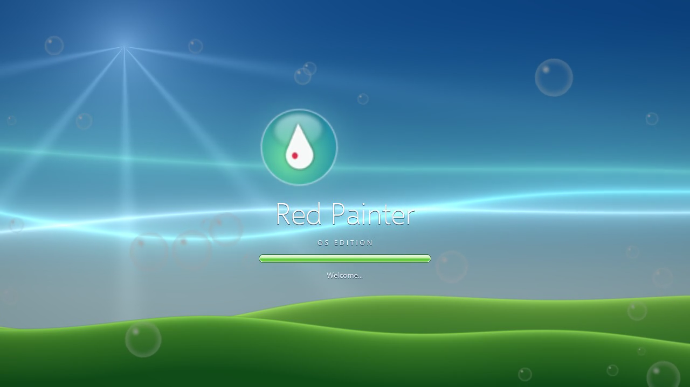
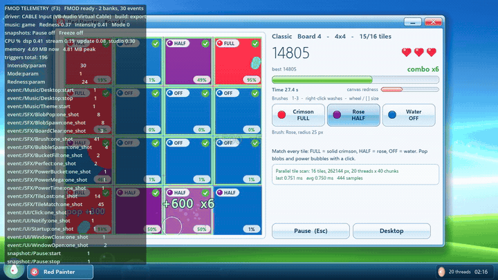
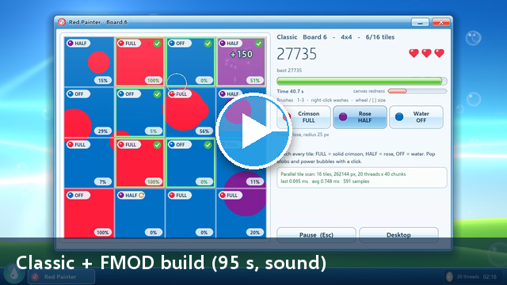
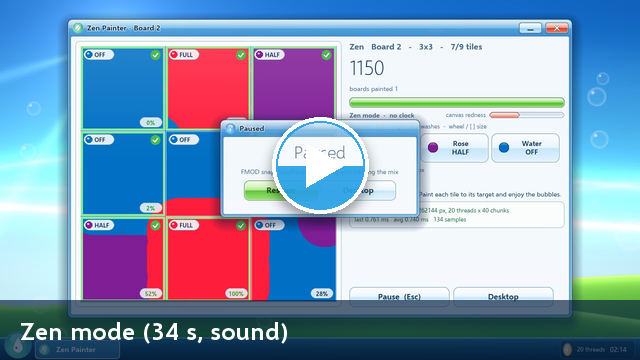
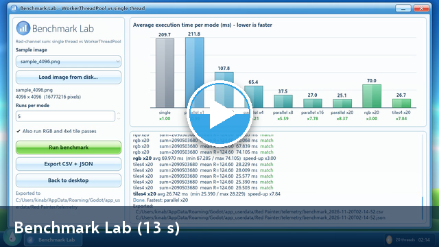
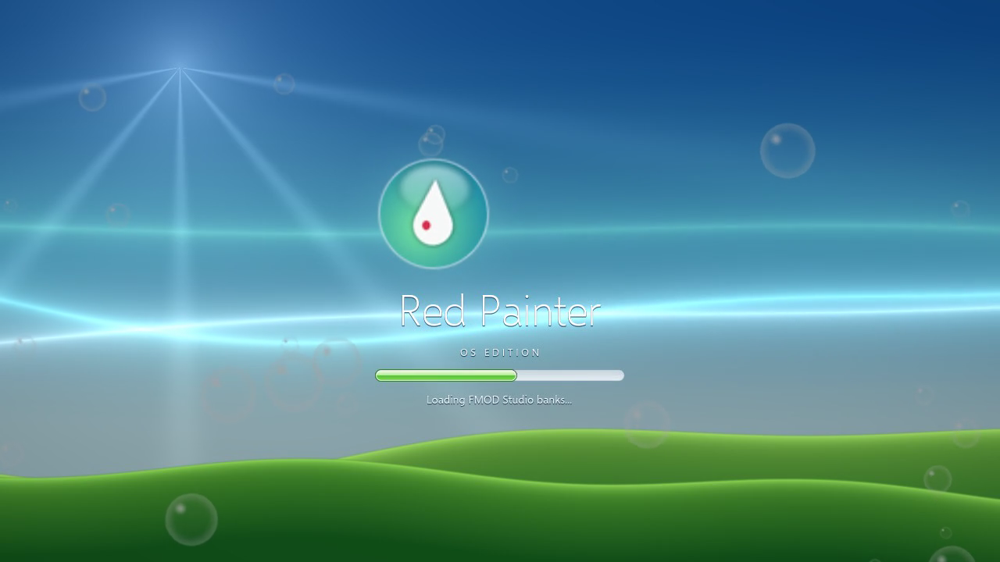
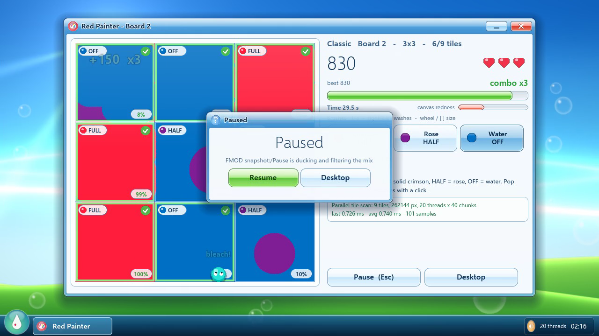
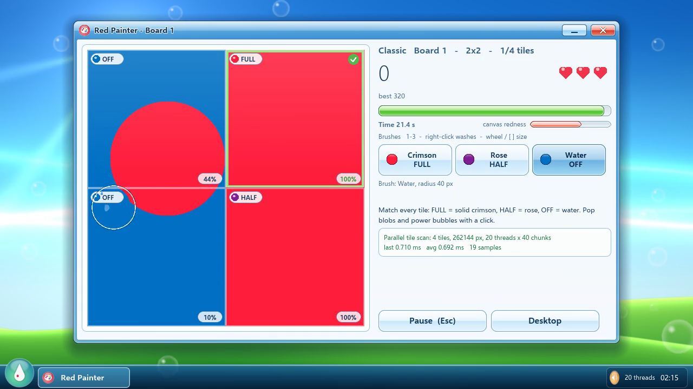

# Red Painter: OS Edition



A Frutiger Aero speed-painting puzzle game made in Godot 4.7, with FMOD Studio audio and a parallel red-channel scanner. It covers both weekly mini-projects:

This was actually a super fun project to make because I had a ton of fun working out how I could take very non creative idea like parallel processing and turn it into a game. everything else is frutiger aero just because i like frutiger aero aesthetics! :D 

- **Parallel processing:** the canvas (or any image loaded from disk) has its red channel summed across all CPU cores with Godot's `WorkerThreadPool`, the Godot equivalent of Unity Jobs and Unreal `ParallelFor`. Per-tile sums score the game ten times a second. The **Benchmark Lab** compares single-thread with 1 to N workers, charts the results and exports CSV/JSON.
- **Audio middleware:** FMOD Studio runs through `fmod-gdextension`: 28 events, 2 snapshots, 5 parameters, 3 buses and 2 VCAs, all generated by script and validated in the exported Windows build.

Write-up / devlog: [COMMENTARY.md](COMMENTARY.md) · Evidence: [media/](media/README.md) · Credits: [CREDITS.md](CREDITS.md)

## See it in action


Click a picture to watch the full video. The clips with sound are FMOD's real output from the exported build.

| Classic + FMOD build | Zen mode | Benchmark Lab |
|---|---|---|
| <a href="media/fmod_build.mp4"></a> | <a href="media/zen_mode.mp4"></a> | <a href="media/benchmark.mp4"></a> |
| Boot, desktop, boards 1 to 9, power-ups, Pause snapshot, F3 telemetry | Underwater music (`Mode` = 1), Mega brush | 4096² image from disk, single vs 1 to 20 threads |

| Boot | Pause snapshot | F3 FMOD telemetry |
|---|---|---|
|  |  |  |

## Play
**Windows build:** unzip `RedPainter-win64.zip` (see Releases) and run `RedPainter.exe`. **From source:** open `parallel-gaming/project.godot` in Godot 4.7 and press **F5**.

The game boots to a desktop. Double-click **Red Painter** (Classic) or **Zen Painter**, or use the start orb.

| Control | Action |
|---|---|
| Left mouse | Paint, or pop a blob or power bubble |
| Right mouse | Wash with water |
| 1 / 2 / 3 | Crimson (FULL) / Rose (HALF) / Water (OFF) |
| Wheel, `[` `]` | Brush size |
| Esc | Pause (FMOD `snapshot:/Pause`) |
| F3 | Live FMOD telemetry |

**Rules:** match every tile to its target before the clock runs out. Quick matches chain into combos, and a board cleared without losing a tile is a PERFECT. Teal bleach blobs and pink spiller blobs ruin your paint, and from board 5 some tiles shift their target. Power bubbles give you Freeze, Bucket fill, Mega brush, Rinse or +6 s. Zen mode drops the clock, lives and blobs.

## Repo layout
```
parallel-gaming/            Godot project
  scripts/red_sum.gd        single, parallel, per-tile and RGB sums (WorkerThreadPool)
  scripts/game.gd           game loop, tiles, blobs, power bubbles, Zen mode
  scripts/aero.gd           Aero theme, taskbar, start menu, app launcher (autoload)
  scripts/aero_window.gd    draggable glass windows
  scripts/main_menu.gd      the desktop: icons, Welcome, Help, Mixer, Scores, System Info
  scripts/boot.gd           boot screen
  scripts/audio.gd          FMOD wrapper: music, params, snapshots, VCAs, logs, F3 overlay
  scripts/benchmark.gd      Benchmark Lab
  scripts/telemetry.gd      CSV/JSON export
  scripts/demo_bot.gd       autoplay for recordings (--demo)
  scripts/capture.gd        in-engine frame capture (--record)
  ui/                       generated art, wallpaper shader, Selawik font
  banks/Desktop/            built FMOD banks
  tests/test_red_sum.gd     headless correctness test
  tools/make_ui.py          generates the glossy UI art
fmod-project/
  RedPainter/               FMOD Studio project (generated)
  source_audio/             licensed music and SFX (see CREDITS.md)
  tools/build_project.js    builds the whole Studio project and banks
docs/                       FMOD setup, itch.io page text
media/                      videos, GIFs, screenshots, logs
```

## Build and test
```powershell
godot --headless --path parallel-gaming --script res://tests/test_red_sum.gd
```

```powershell
godot --headless --path parallel-gaming --export-release "Windows Desktop" ../build/release/RedPainter.exe
```

```powershell
& "C:\Program Files\FMOD SoundSystem\FMOD Studio 2.03.15\fmodstudiocl.exe" -script fmod-project/tools/build_project.js fmod-project/RedPainter/RedPainter.fspro
```

Command-line switches (after `--`): `--autobench --image=<path> --hold=<s>`, `--demo`, `--demo-zen`, `--skip-boot`, `--fmod-driver=<name>`, `--record=<dir>`, `--quit-after-seconds=<s>`.

Telemetry goes to `%APPDATA%\Godot\app_userdata\Red Painter\telemetry\`: `benchmark_*.csv|json`, `game_session_*.json`, `audio_log_*.csv` and `fmod_perf_*.csv`.
